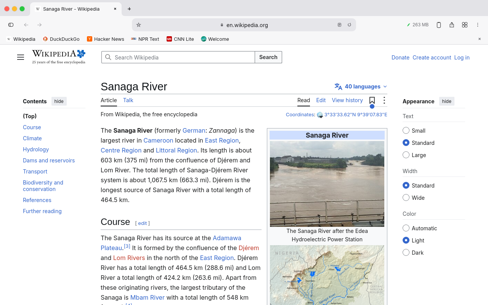
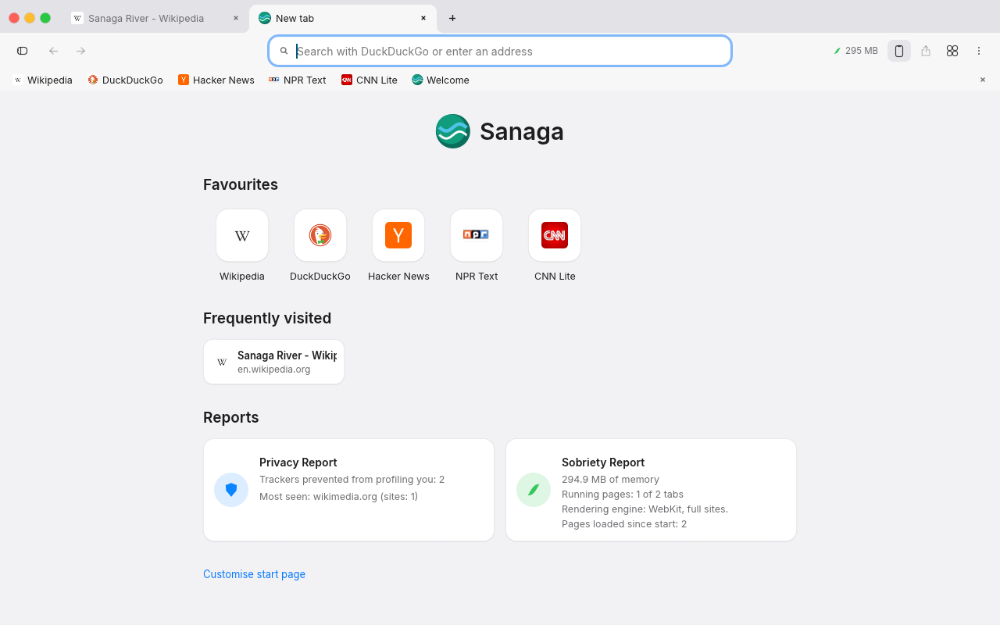
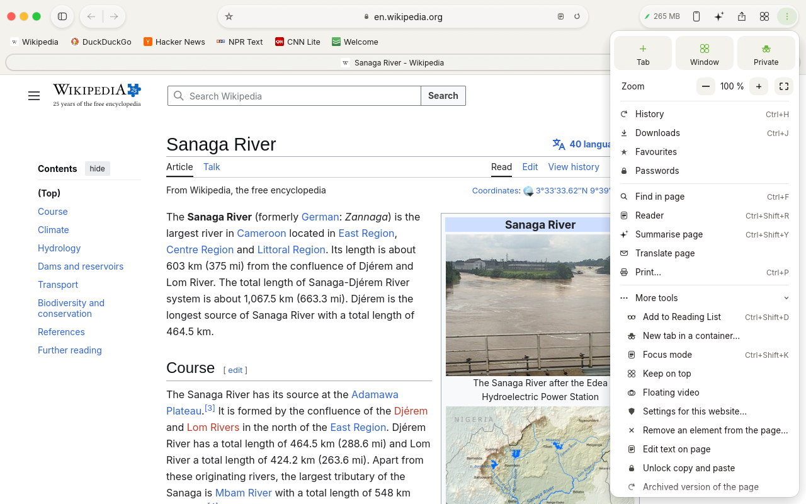
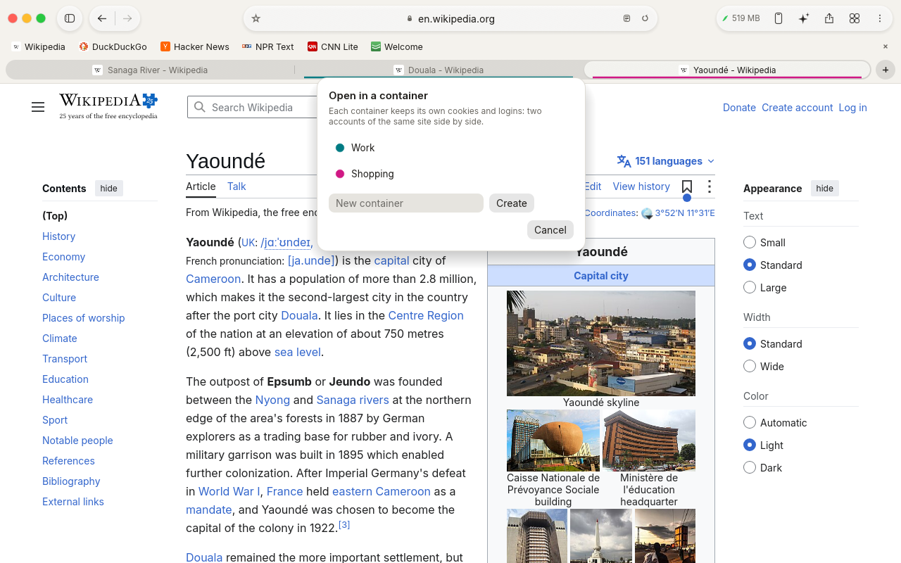
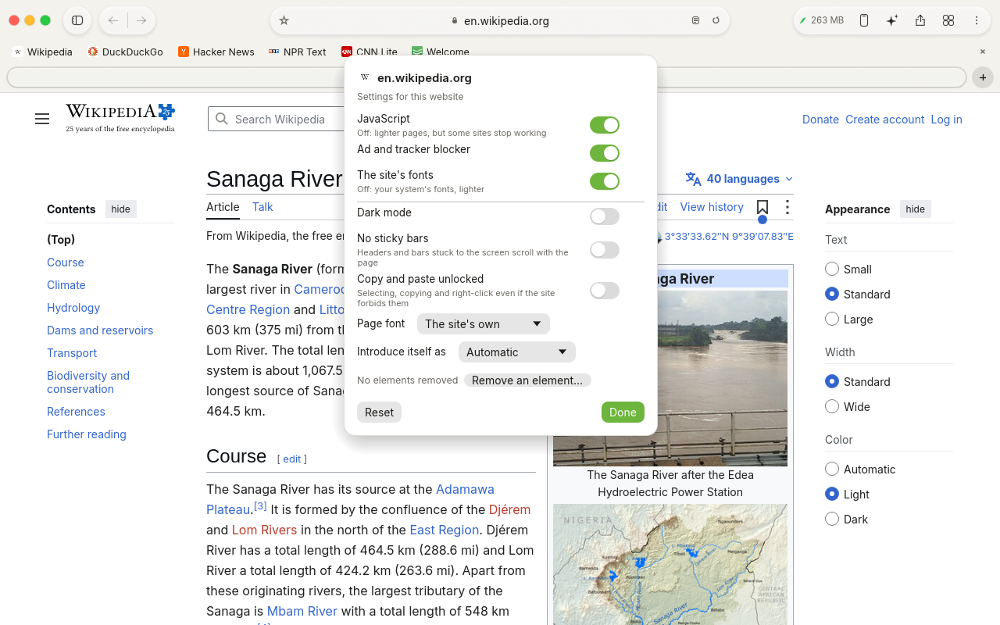
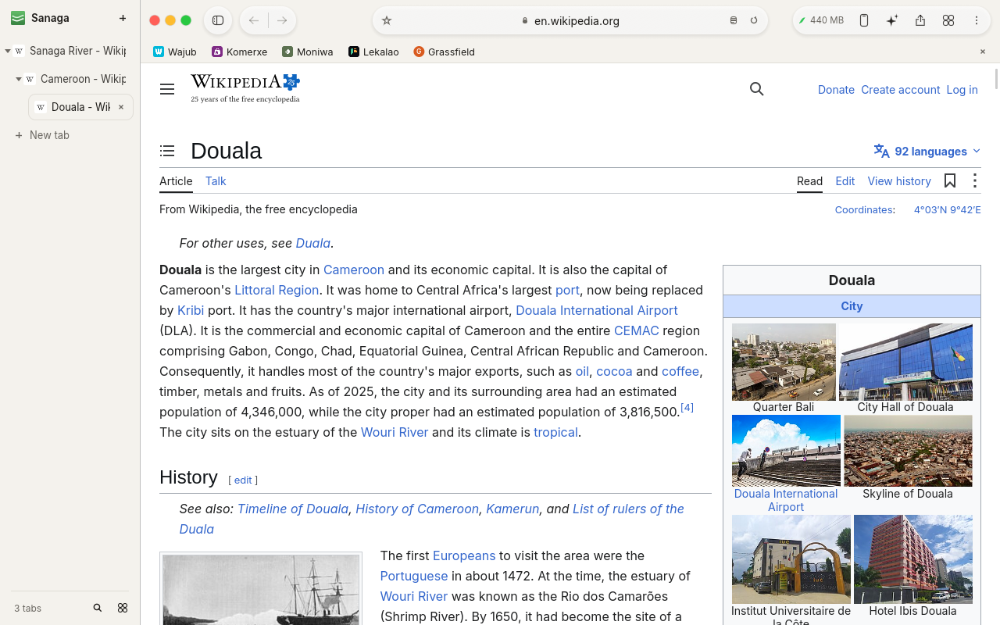
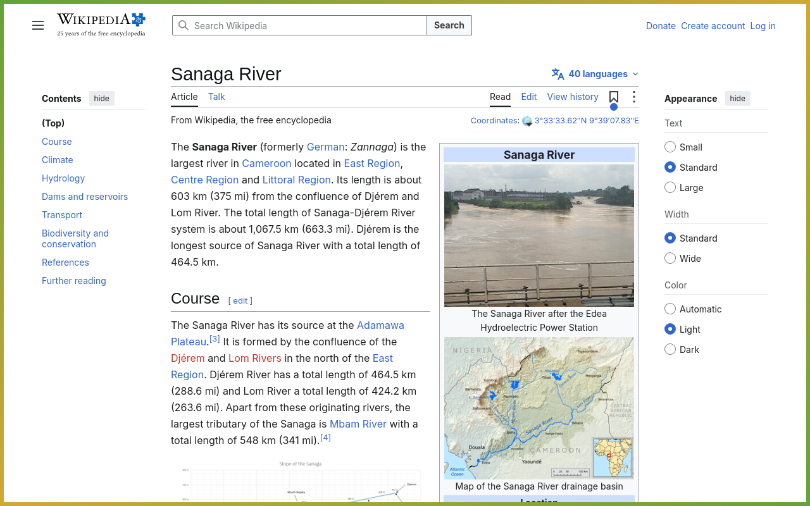
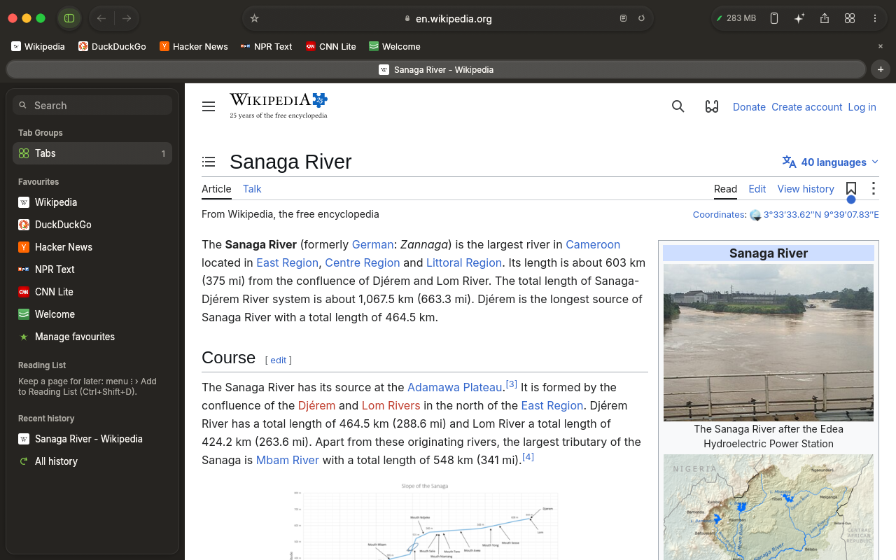
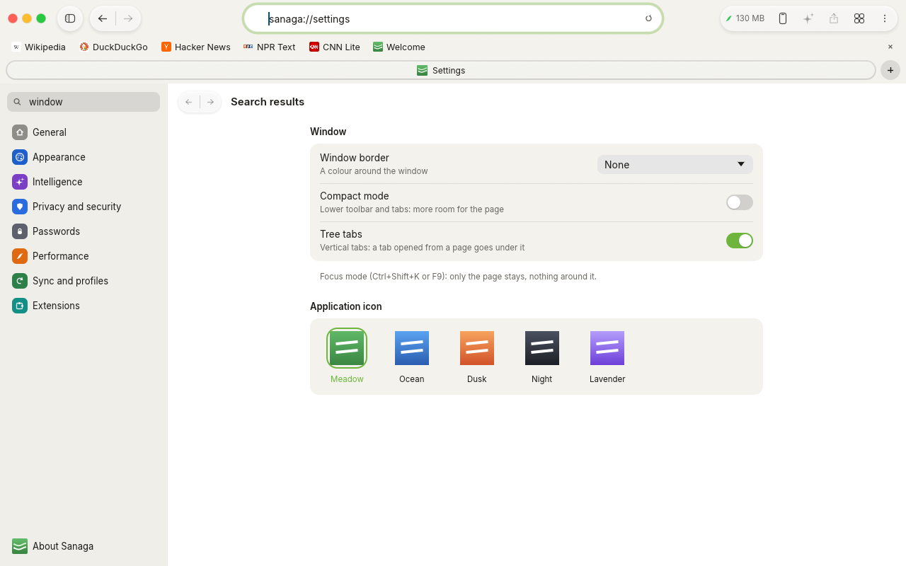
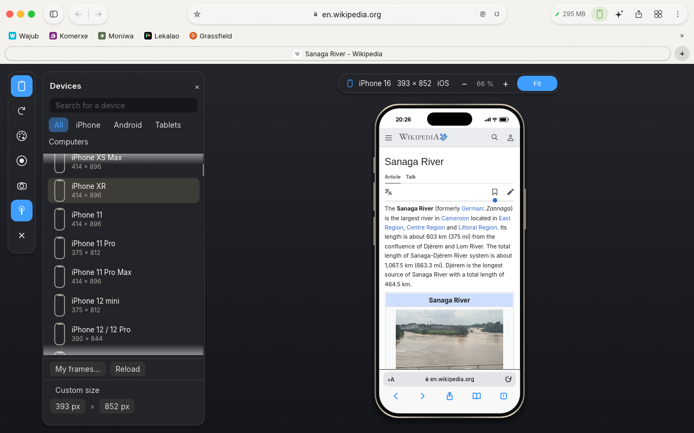

# Sanaga

**A fast, light web browser for Linux** — built in Rust on GTK 4 and
WebKitGTK 6, with a Safari-inspired window, Chrome-style tabs and groups,
containers, a network ad blocker, per-site settings, page tools and a built-in
mobile simulator for web developers.

Sanaga is named after the Sanaga, the longest river in Cameroon.



| New tab | Menu and page tools |
|---|---|
|  |  |

| Containers | Settings for this website |
|---|---|
|  |  |

| Tree tabs (vertical) | Focus mode with a window border |
|---|---|
|  |  |

| Sidebar, dark look | Settings |
|---|---|
|  |  |

| Mobile simulator |
|---|
|  |

---

## Why Sanaga

- **Light on memory.** Tabs only start their page when you first show them,
  a memory saver puts long-unused tabs to sleep, and only a few web pages run
  at the same time. A hundred open tabs do not mean a hundred running pages.
- **Quiet when idle.** The interface only redraws when something changes; a
  still page costs nothing. Low power mode on battery.
- **Native and smooth.** One native GTK 4 window (Wayland or X11): the page and
  the interface are composed together on the graphics card.
- **Private and safe by default.** Pages run in a sandbox, cross-site tracking
  prevention, a network blocker of ads and trackers (the requests never
  leave), containers, a privacy report, passwords kept in the system keyring,
  no telemetry, no account.

## Features

**Browsing**
- Full web engine (WebKitGTK 6), plus an optional *Light* engine for very fast,
  simplified pages.
- Address bar with suggestions (history, bookmarks, open tabs, calculator,
  search shortcuts), arrow-key navigation, site info and zoom per site.
- Reader mode, find in page, print, save page, full screen, page source view
  with colours, line numbers and line wrapping (Ctrl+U).
- Built-in PDF reader (search, zoom, print, annotations).
- Files the browser can't show (archives, installers…) are downloaded; a
  downloads bar and page.
- Translation of the page with Google, or in place with the AI of your choice
  (Claude Code, Codex, Claude, a local Ollama model — offline).
- Page summaries (✦, Ctrl+Shift+Y) and extensions written from a description.

**Tabs and windows**
- Chrome-style tab row: pinned tabs, drag to reorder, tab groups with colours,
  folding and naming, mute, duplicate, “new tab to the right”, reopen closed tab.
- Many tabs: arrows and a counter open the searchable list of all tabs; tab
  overview with thumbnails (Ctrl+Shift+O); tab search (Ctrl+Shift+A).
- Vertical tabs as a **tree**: a tab opened from a page goes under it; fold a
  branch, close it in one go.
- Several windows (Ctrl+N), all restored at start; move a tab or a whole tab
  group to its own window; the sidebar lists the open windows.
- Unified sidebar: tab groups, windows, favourites, reading list, history.
- Link preview in a small window (right-click a link, or `sanaga --preview URL`
  from another application).

**Privacy and security**
- **Containers**: tabs with their own cookies, logins and site data — two
  accounts of one site side by side (right-click a tab or a link › Open in a
  container).
- **Network blocker** of ads and trackers (on by default, per-site switch),
  plus cookie-banner hiding.
- Cross-site tracking prevention with a privacy report; no `<a ping>`; videos
  never start with sound; notification requests refused quietly.
- Passwords and AutoFill in the system keyring; import of bookmarks, history
  and passwords from Chrome, Chromium, Brave, Edge, Vivaldi and Firefox.
- Private tabs, profiles (each with its emoji and its own launcher in your
  applications), sync of bookmarks, reading list and open tabs through any
  shared folder (Syncthing, Nextcloud, a USB key…).
- Per-site browser identity (Automatic, Safari, Chrome, Firefox) for the few
  web apps that refuse WebKit; DRM services (Netflix, Spotify…) are recognised
  and opened in an app or browser that can play them.

**Website settings** (right-click in a page › Settings for this website…)
- JavaScript, web fonts and the blocker, site by site.
- The page's look: dark mode, another font, no sticky headers and bars.
- Copy and paste unlocked on sites that forbid it.
- Parts of the page removed for good (element remover), restored in one click.

**Page tools**
- Floating video: the page's video in a small window kept above the others.
- Remove an element, edit the page's text (for a screenshot or a mock-up),
  archived version of the page (Internet Archive, also offered when a site
  doesn't load).

**Look and comfort**
- macOS-27-style window: toolbar capsules, tab pills, floating sidebar.
- Your layout: tabs on top, at the bottom or down the side; address bar on
  top, at the bottom or floating; compact mode.
- Focus mode (F9): only the page. Keep the window on top.
- Window border: accent colour, gradient or animated colours.
- Accent colour and light/dark follow the system (Grassfield) or your choice;
  five application icon colours.
- Your own toolbar buttons (an address, a Sanaga command or your script) and a
  » menu to tuck buttons away; right-click the toolbar to choose its buttons.
- Touchpad swipe and mouse side buttons for back/forward, native tooltips.
- Welcome tour with the first choices; macOS-style Settings with search.
- Screen readers: the interface and the pages are published over AT-SPI.
- Interface in English, French, Spanish, Portuguese and German.

**Extensions**
- Built-in: no cookie banners, no autoplay, dark mode for every site.
- Extensions made for Chrome (`.crx`, `.zip`, unpacked folder) or Firefox
  (`.xpi`) that act inside pages, and user scripts (`.user.js`) —
  Settings › Extensions › Install an extension…
- Your own `.js` / `.css` files, or extensions written for you from a
  description (Sanaga alone, Ollama, Claude, Claude Code, Codex).
- Switching one on or off applies at once to the open pages.

**For web developers**
- Web inspector (Ctrl+Shift+I or F12), docked or in its own window.

**Mobile simulator** (Ctrl+Shift+M, or the phone button)
- 120 devices: iPhone, Pixel, Galaxy, Tecno, Infinix, itel, Xiaomi, OnePlus…,
  tablets and computers, or any free size; portrait and landscape; zoom.
- Drawn device frames (camera island, notch, punch-hole, home button, tablet,
  laptop, monitor) in five colours, with a status bar.
- The device's own browser around the page: Safari-style bars on Apple
  devices, Chrome-style bars on Android and computers. Their back, forward,
  reload buttons and the address field work.
- Mobile browser identity (iOS / Android user agent) and touch emulation, so
  sites send their mobile version.
- Screenshots (with the device, screen only, whole page) and **video
  recording** (MP4) of the device.
- Your own frame pictures: put a PNG with a transparent screen in the frames
  folder, named like the device; Sanaga finds the screen by itself.

## Install

Sanaga runs on Linux (Wayland or X11). You need:

| What | Arch / Manjaro | Debian / Ubuntu (24.04+) | Fedora |
|---|---|---|---|
| Rust 1.88+ | `rustup` | `rustup` | `rustup` |
| GTK 4 | `gtk4` | `libgtk-4-dev` | `gtk4-devel` |
| WebKitGTK 6 | `webkitgtk-6.0` | `libwebkitgtk-6.0-dev` | `webkitgtk6.0-devel` |
| Video codecs (YouTube…) | `gst-libav` `gst-plugins-bad` `gst-plugin-va` | `gstreamer1.0-libav` `gstreamer1.0-plugins-bad` `gstreamer1.0-vaapi` | `gstreamer1-plugin-libav` `gstreamer1-plugins-bad-free` |
| *(optional)* passwords | `libsecret` (`secret-tool`) | `libsecret-tools` | `libsecret` |
| *(optional)* video recording | `ffmpeg` | `ffmpeg` | `ffmpeg` |

Then:

```sh
git clone https://github.com/grassfieldhq/sanaga.git
cd sanaga
cargo build --release
./target/release/sanaga
```

To install it for your user — program in `~/.local/bin`, launcher in your
applications menu, icon — without admin rights:

```sh
packaging/install.sh              # build and install
packaging/install.sh --uninstall  # remove it (your data stays)
```

## Usage

```sh
sanaga [address …]            # open these addresses (or restore the last session)
sanaga --profile Work         # use the "Work" profile (its own data)
sanaga --app https://…        # open one site on its own, as a web app
sanaga --new-window           # a new window in the running Sanaga
sanaga --preview https://…    # preview a link in a small window
sanaga --reader https://…     # open in Reader mode
sanaga --apercu               # start on the tab overview
sanaga --screenshot out.png   # draw the window once, save a picture, quit
```

### Keyboard shortcuts

| Action | Keys |
|---|---|
| New tab / close tab | Ctrl+T / Ctrl+W |
| New window | Ctrl+N |
| Reopen closed tab | Ctrl+Shift+T |
| New private tab | Ctrl+Shift+N |
| Next / previous tab | Ctrl+Tab / Ctrl+Shift+Tab |
| Address bar | Ctrl+L, F6 |
| Reload | Ctrl+R, F5 |
| Back / forward / home | Alt+← / Alt+→ / Alt+Home |
| Find in page | Ctrl+F |
| Bookmark this page / bookmarks bar | Ctrl+D / Ctrl+Shift+B |
| Add to reading list | Ctrl+Shift+D |
| History / downloads | Ctrl+H / Ctrl+J |
| Reader | Ctrl+Shift+R |
| Tab overview / tab search | Ctrl+Shift+O / Ctrl+Shift+A |
| Sidebar | Ctrl+Shift+L |
| Zoom in / out / reset | Ctrl++ / Ctrl+− / Ctrl+0 |
| Page source / print / save | Ctrl+U / Ctrl+P / Ctrl+S |
| Web inspector | Ctrl+Shift+I, F12 |
| Mobile simulator | Ctrl+Shift+M |
| Page summary | Ctrl+Shift+Y |
| Focus mode | F9 |
| Fill in my contact details | Ctrl+Shift+F |
| Full screen | F11 |
| Clear browsing data | Ctrl+Shift+Delete |

### Where your data is

Everything stays on your computer, in `~/.local/share/sanaga/`
(or `$XDG_DATA_HOME/sanaga/`): settings, history, bookmarks, session, site
data (`webkit/`, and `webkit/containers/<name>/` for each container), website
settings (`sites.tsv`), your toolbar buttons (`buttons.tsv`), extensions
(`extensions/`), device frames (`cadres/`), and one sub-folder per extra
profile (`profils/<name>/`). Passwords are not stored
there: they go to the system keyring.

## How it is built

| Part | Files |
|---|---|
| Native window: GTK 4 window, the interface drawn by [egui](https://github.com/emilk/egui) in a GL area, pages as WebKit widgets on top, input and window commands | `src/shell.rs` |
| One web page (WebKitGTK view, scripts, downloads, signals, blocker, website settings applied) | `src/page.rs`, `src/site_prefs.rs` |
| Page tools, containers, website settings panel, toolbar buttons | `src/app/tools.rs`, `src/app/containers.rs`, `src/app/sitepanel.rs`, `src/app/buttons.rs` |
| Extensions (built-in, files, Chrome / Firefox packages) | `src/extensions.rs`, `src/webext.rs` |
| The interface (tabs, toolbar, menus, internal pages, simulator…) | `src/app/` |
| Light engine (HTML to blocks, Reader) | `src/html.rs`, `src/net.rs` |
| Saved data, profiles, sync, keyring, imports | `src/store.rs`, `src/sync.rs`, `src/keyring.rs`, `src/migrate.rs`, `src/import.rs` |
| Device frames and drawn mobile browsers (cairo) | `src/frames.rs`, `src/app/devices.rs`, `src/app/scene.rs` |
| Translations | `src/i18n.rs`, `assets/i18n/` |

`eframe` is only used for `--screenshot` (a picture of the interface without
web engine). Comments in the code explain *why* things are done the way they are.

## Platforms

| System | Status |
|---|---|
| Linux (Wayland, X11) | ✅ Supported |
| FreeBSD and other BSDs | Should work (GTK 4 and WebKitGTK are available), untested |
| Windows | ❌ Not yet — planned, see [docs/PORTING.md](docs/PORTING.md) |
| macOS | ❌ Not yet — planned, see [docs/PORTING.md](docs/PORTING.md) |

Building on Windows or macOS stops with a clear message. The interface code
(egui) already runs everywhere; the parts to port are the window, the web
engine bridge and a few system services.

## Known limitations

- Linux only for now (GTK 4 + WebKitGTK 6) — see [Platforms](#platforms).
- Chrome and Firefox extensions work when they act inside pages; those needing a
  background service or a pop-up (password managers…) are not supported
  (WebKitGTK has no extension API).
- Video sites (YouTube…) need the GStreamer codecs above (H.264, AAC, AV1,
  Opus). Sanaga checks them and installs them in one click (Settings ›
  General › Video and music, or the bar shown on the site).
- DRM video (Netflix, Disney+, Prime Video, Spotify web…) needs Widevine,
  which no WebKitGTK browser has. Sanaga opens these sites in the Spotify app
  or in an installed browser that has Widevine (Chrome, Chromium with
  Widevine, Brave, Edge, Vivaldi, Firefox) — as an app window, and by itself
  if you choose so.
- Keeping a window on top and placing the floating video are done with
  Hyprland; on other desktops the desktop decides.
- Emoji typed in Sanaga's own interface show as initials (its fonts have no
  colour emoji); pages show them normally.
- Video recording has no sound; its size is the device's size on screen (use
  100 % zoom for sharper videos).
- Window moving, maximising and the title bar integration have extra support for
  Hyprland; other desktops use the standard GTK behaviour.

## Review

A strict, feature-by-feature check of Sanaga, with what was fixed:
[docs/REVIEW.md](docs/REVIEW.md).

## Audit

What people dislike in Chrome, Firefox and Safari, checked against Sanaga:
[docs/AUDIT.md](docs/AUDIT.md).

## Roadmap

What is left before Sanaga is a production-ready daily browser, in order:
[docs/PRODUCTION.md](docs/PRODUCTION.md).

## Contributing

Contributions are welcome — bug reports, translations, devices, code. Please read
[CONTRIBUTING.md](CONTRIBUTING.md) and our [Code of Conduct](CODE_OF_CONDUCT.md).
Security issues: see [SECURITY.md](SECURITY.md).

## License

Sanaga is released under the [MIT License](LICENSE).
The bundled fonts (Inter, Noto Sans, Noto Serif) are under the SIL Open Font
License 1.1 — see [assets/FONTS-LICENSE.md](assets/FONTS-LICENSE.md).

*Sanaga is an independent project. It is not affiliated with Google, Apple,
Samsung or any other company. Product names such as Chrome, Safari, iPhone,
iPad, Pixel or Galaxy are used only to describe what the simulator imitates;
they belong to their owners. The device frames and browser bars are drawn by
Sanaga itself and contain no third-party logos or artwork.*
